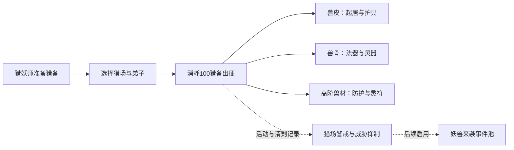

# 妖兽狩猎与兽材利用

更新：2026-10-12。**旧驯养支线移除和旧档补偿已实现；新狩猎体系仍为待实现方案。** 本文是后续实现的工作草案，所有产量、门槛、时长和技艺数值均需实测。当前数据见 [TABLES.md](TABLES.md)，通用规则见 [DESIGN.md](DESIGN.md)，历史测量见 [BALANCE.md](BALANCE.md)。

## 1. 目标与范围

核心循环：猎妖师准备猎备 → 玩家选择猎场和弟子 → 消耗 100 猎备出征 → 归队取得兽材 → 用于起居、炼器与防护。

用户已确定的方向：每次选择猎场；回报同时考虑个人与宗门境界；高级妖兽提供高级材料；狩猎技艺改善成功率、收获和耗时；预留与妖兽来袭的关联。每队最多 5 人、同时 1 队、初始猎备仓容 300 是首轮规模建议。

捕猎本身不直接增加永久宜居度，材料用于保暖、陈设和法宝后才兑现效果。首期不加入装备槽、逐只战斗、弟子伤残或死亡，也不把狩猎列为突破的必修路线。



## 2. 资源、猎场与开放顺序

| 资源 | ID | 来源与用途 |
| --- | --- | --- |
| 猎备 | `huntPreparation` | 猎妖师岗位产出；每次出征扣 100，可保留小数 |
| 灵兽皮 | `beastHide` | 山麓普通材料；生活维护、护具与祭炼 |
| 灵兽骨 | `beastBone` | 山麓普通材料；基础炼器、设施扩建 |
| 玄纹骨 | `runedBone` | 深山进阶材料；灵器、进阶法宝 |
| 灵韧皮 | `spiritHide` | 深山进阶材料；灵幡、护具、灵符 |
| 兽魂晶 | `beastSoulCrystal` | 禁地进阶材料；镇守法宝与凝魂灵符 |

兽材按整数入库，小数收益按资源累计，不在每次归队时直接丢弃。暂不增加兽肉、熟皮、骨粉或妖丹加工链；妖丹作为妖兽分阶设定，待有独立用途时再成为库存。普通兽材不能合成高阶特产，高阶兽材也不自动折算为普通材料。

境界下标沿用代码：凡体 0、引气 1、炼气 2、筑基 3、金丹 4、元婴 5、化神 6、炼虚 7、合体 8、大乘 9、渡劫 10。

| 猎场 / 稳定 ID | 宗门入口 U | 弟子最低境界 R | 推荐境界 D | 基础时长 T_base | 普通档 → 进阶档 |
| --- | --- | --- | --- | --- | --- |
| 山麓 `foothills` | 筑基 3 | 凡体 0 | 筑基 3 | 120 秒 | 普通皮骨，无进阶档 |
| 深山 `deepForest` | 元婴 5 | 筑基 3 | 元婴 5 | 180 秒 | 少量普通皮骨 → 玄纹骨、灵韧皮 |
| 禁地 `forbiddenGrounds` | 炼虚 7 | 元婴 5 | 炼虚 7 | 300 秒 | 少量玄纹骨、灵韧皮 → 兽魂晶 |

高级猎场侧重高级材料，不能顺带完全替代山麓起居供给。每档材料开放时，至少有一种当期可用的消费用途。

| 研究 / 设施 | 前置与首轮投入 | 功能 |
| --- | --- | --- |
| 山野猎法 | 灵植术、引泉净水；灵机 300、灵木 200、灵石 30 | 开放营地和暖裘居室 |
| 狩猎营地 | 筑基、山野猎法；灵木 500、矿石 200、灵石 60 | 开放猎妖师和山麓；首座猎备仓容 300、兽皮仓容 200、兽骨仓容 150 |
| 兽材加工 | 山野猎法、炼器术；灵机 1500、普通骨皮各 40 | 开放兽骨炼器、御寒灵裘 |
| 深山猎法 / 猎营 | 研究承接兽材加工、凝晶原理；设施元婴开放 | 使用前阶兽材、玄钢和阵基建设，开放深山及对应仓储 |
| 禁地讨妖 / 猎营 | 研究承接深山猎法、阴阳分灵；设施炼虚开放 | 使用深山兽材和秘银建设，开放禁地及魂晶仓储 |

研究通过知识链与灵机费用推进，境界门槛放在设施、配方及出征准入。首座设施和入口研究不使用其自身猎场特产，避免自锁。营地扩建暂按 1.35 倍涨价，只扩仓，不增加队伍人数或直接增加奖励。猎备仓容单独配置，不套用所有通用仓储加成。

## 3. 后勤、出征与任务状态

### 3.1 猎妖师与猎备

猎妖师 `huntPlanner` 在启用中的营地准备，不直接产出兽材。基础速度暂定 0.20 猎备/秒·人，沿用普通岗位规则：

```text
P = 0.20 × Σ REALMS[min(个人境界, 宗门境界)].mult
         × 宗门境界倍率 × 其他适用岗位和生产倍率
准备等待 = max(0, 100 - 库存) / P
```

P 为当前留在营地、没有出征的猎妖师总准备速度；P=0 时显示无准备来源。个人与宗门倍率只在普通岗位公式中各计一次，点数和准备速度不再乘进出征奖励。

不计其他加成时，1 名凡体弟子在筑基宗门为 0.32 点/秒，约 313 秒准备一次；筑基弟子为 0.512 点/秒，约 195 秒；元婴弟子在元婴宗门为 1.352 点/秒，约 74 秒。

初始库存 0，每次只扣 100；250 点出发后剩 150。达到 100 只是允许出发，不强制启动任务。首轮上限 300，额外准备到达上限后停止积累，不能越仓或换成奖励。阈值判断使用真实库存和统一数值容差，不用显示取整后的值判断。

### 3.2 一次出征的生命周期

1. **选择**：玩家指定猎场和 1～5 名不同弟子；检查研究、设施、宗门与每名弟子的有效境界，以及成员可用性。
2. **出发**：确认猎备至少 100 且无活动任务；原子扣点、占用成员、保存快照和任务ID，连续点击不能重复支付或派出。
3. **执行**：按实际时间推进。成员停止原岗位工作，仍修炼、累计停留和普通口粮；期间不能转岗、逐出或参与其他任务。
4. **归队**：判定并一次性结算材料、统计和生态；释放成员，恢复原分工，原岗位已失效则回空闲。
5. **再次出发**：手动选择或使用自动重复配置，重新检查并再次支付 100。

出征是一种成员占用状态，不另建持续生产兽材的岗位。选择猎妖师出征时，其准备贡献立即暂停；返回后恢复。收益和耗时只按真实成员计算，不补虚拟队员；人数影响总回报，不影响基础行程时长。

猎场、人数、成员身份、宗门及有效个人境界、成功率、缩时技艺、基础掉落表和公式版本在出发时快照固定。途中修改配置、突破或学习这些技艺只影响下一次。收获与临时增益按实际覆盖时间累计。

取消任务立即归队，不发半程兽材，不退 100 猎备，也不回滚已经发生的猎场活动记录。退境、停用或拆除猎营不重算当前已支付任务；当前任务可完成，下一次必须重新满足准入。飞升或转世清空本世活动任务、猎备及生态，不能重置后领取旧任务收益。

自动重复默认关闭。开启后按指定猎场和成员名单执行，不自动换人、补人或升级猎场；缺点等待，成员不合格或设施不可用时暂停并说明原因。归队、恢复岗位、下一次扣点和占用在同一结算边界处理，不凭空插入一段工作收益。

所有该猎场产物都已达到库存目标或满仓时，自动重复等待；部分材料可收取时允许继续，显示其他材料可能溢出。手动出发允许玩家确认溢出，不建立无限待领取仓库。

### 3.3 长期供给与离线

准备人员与队伍稳定、准备不中断、自动重复且有足够缓冲时：

```text
平均出征间隔 ≈ max(T_actual, 100 / P)
材料平均秒产 ≈ 单次期望回报 / 平均出征间隔
```

无缩时技艺时，连续山麓、深山、禁地分别需要准备速度至少 0.833、0.556、0.333 点/秒。缩时后猎备消费更频繁；准备不足时，缩时主要减少弟子占用，不会按相同比例提高材料产量。

离线同时推进准备和任务，按满 100、归队和增益到期边界逐次结算；保持当前离线时限。不能拿一趟快照直接乘离线总时长，也不在离线新抽来袭事件。读档恢复已付任务，不能再次扣点或重发奖励。

## 4. 成功率、材料等级与收益公式

以下所有参数均为试调值。每名弟子分别计算再相加，不使用平均境界，也不让强者的境界代替全队。

```text
e_i = min(个人境界 r_i, 出发时宗门境界 S)
A_i = 2 ^ clamp((e_i - D_h) / 2, -2, 1)
C_h = 1 + 0.10 × clamp(S - U_h, 0, 4)
p_i = clamp(p_base,h + 0.06 × (e_i - D_h)
                     + 0.02 × clamp(S - U_h, 0, 3)
                     + Σ huntSuccessBonus, 0.35, 0.99)
```

A 是个人效率，范围 0.25～2；匹配推荐境界为 1，低两阶为 0.5，高两阶为 2。C 是宗门支援，最高 1.4。基础成功率 p_base 分别为山麓 0.90、深山 0.80、禁地 0.70；每名弟子每次只判定一次，其全部材料共用结果。独立随机序列用于狩猎，预览不消耗随机数，读档不重抽已结算结果。

山麓进阶占比 q=0；深山、禁地为：

```text
q_i = clamp(0.20 + 0.20 × (e_i - R_h)
                  + 0.05 × clamp(S - U_h, 0, 2), 0, 0.90)
```

q 是贡献分配到进阶档的比例，p 是猎杀成功率，两者独立。高境界可同时提高效率、成功率与进阶占比，但不突破猎场材料上限。由于更多贡献转向高级材料，同一猎场的普通档产量不保证随境界单调增加。

| 材料档位 | 分配系数 w | 成功系数 Z | 预览期望 E[Z] |
| --- | --- | --- | --- |
| 山麓基础档 | 1 | 成功 1，失败 0.20 | p + 0.20×(1-p) |
| 深山 / 禁地普通档 | 1-q | 成功 1，失败 0.20 | p + 0.20×(1-p) |
| 深山 / 禁地进阶档 | q | 成功 1，失败 0 | p |

失败的普通档是沿途采集保底，不猎获目标的高阶特产；仍消耗时间和猎备。每人分别判定，队伍显示预计成功人数 Σp，不把它叫作整队成功概率。小数保底可能暂未凑成整数，界面显示累计进度，不能承诺每次都有整数材料到账。

| 猎场 | 普通档基准秒产 b | 进阶档基准秒产 b |
| --- | --- | --- |
| 山麓 | 兽皮 0.12、兽骨 0.08 | 无 |
| 深山 | 兽皮 0.03、兽骨 0.02 | 玄纹骨 0.03、灵韧皮 0.04 |
| 禁地 | 玄纹骨 0.015、灵韧皮 0.02 | 兽魂晶 0.005 |

同档内骨皮同时产生，两档通过 q 分配贡献。最终每种材料为：

```text
H(t) = 1 + min(1.00, Σ huntYieldBonus(t))
G_m(t) = H(t) × 其他适用的非境界倍率
平均增益 Ḡ_m = ∫[0,T_actual] G_m(t) dt / T_actual
Y_h,m = b_h,m × T_base × C_h × Σ(A_i × w_i,m × Z_i,m) × Ḡ_m
```

其他倍率包括适用的宜居、仙缘、道果、资源及临时增益，每项只计一次。狩猎收获技艺和法宝统一进入 H，不在其他倍率里重复叠加；不直接乘含境界的 `derived.globalMult` 或 `discipleFactor`，也不套制作增产。灵根只影响修炼。

缩时后仍用 T_base 计算单次基础回报，实际时长只用于平均增益与任务完成时间。180 秒任务若催猎覆盖 30 秒、期间 +50%，其平均增益为 (150+30×1.5)/180，整次增产 8.33%；不能在返回前点击后追溯整次 +50%。

深山 180 秒，无技艺或其他加成的单人**期望**回报：

| 宗门 / 个人境界 | A | C | q | p | 玄纹骨 | 灵韧皮 |
| --- | --- | --- | --- | --- | --- | --- |
| 元婴 / 筑基 | 0.50 | 1.00 | 20% | 68% | 0.3672 | 0.4896 |
| 元婴 / 金丹 | 约 0.707 | 1.00 | 40% | 74% | 约 1.1302 | 约 1.5070 |
| 元婴 / 元婴 | 1.00 | 1.00 | 60% | 80% | 2.5920 | 3.4560 |
| 炼虚 / 筑基 | 0.50 | 1.20 | 30% | 72% | 约 0.6998 | 约 0.9331 |
| 炼虚 / 元婴 | 1.00 | 1.20 | 70% | 84% | 约 3.8102 | 约 5.0803 |

元婴宗门的筑基＋元婴二人队，期望玄纹骨为 0.3672+2.592=2.9592；两人均成功时才是 3.78。预览、长期测量和维护供给使用期望，实际到账使用本次判定结果。

## 5. 修真研究与强化技艺

修真研究负责猎场和工艺解锁，技艺负责数值强化；强化支线不全部成为进入猎场的必修前置。入口只用原资源或前阶材料，进阶技艺可消费本猎场已能取得的材料。

| 技艺 | 建议前置 | 试调效果 | 投入方向 |
| --- | --- | --- | --- |
| 识踪诀 | 山野猎法 | 成功率 +5 个百分点 | 灵机、灵木、灵石 |
| 剥取法 | 兽材加工 | 收获 +15% | 灵机、普通骨皮 |
| 踏山步 | 山野猎法 | 时长 −10% | 灵机、灵石 |
| 筹猎章 | 山野猎法 | 猎妖师准备速度 +25% | 灵机、灵木 |
| 破妖诀 | 深山猎法、识踪诀 | 成功率 +8 个百分点 | 灵机、玄纹骨、灵液 |
| 取髓诀 | 深山猎法、剥取法 | 收获 +20% | 灵机、玄纹骨、灵韧皮 |
| 缩地行 | 深山猎法、踏山步 | 时长 −15% | 灵机、灵液、玄钢 |
| 镇魄诀 | 禁地讨妖、破妖诀 | 成功率 +8 个百分点 | 灵机、兽魂晶 |
| 敛息法 | 深山猎法，生态关联已启用 | 警戒增量 −20% | 灵机、灵韧皮、灵符 |

```text
时长缩减 = min(0.40, Σ huntDurationReduction)
T_actual = ceil(T_base × (1 - 时长缩减))
```

成功率最高 99%，收获技艺与法宝合计最多 +100%，时长最多缩短 40%。成功率增量按百分点显示，其他按比例显示，使用独立效果字段；筹猎章用 `jobRatio.huntPlanner`。警戒减免也单独配置并限制在 0～80%，只减少新增警戒，不清除旧警戒；未启用生态关联时不开放敛息法。

踏山步和缩地行合计减时 25%，深山从 180 秒变为 135 秒，单次基础回报不变，仍消耗 100 猎备；连续运行所需准备速度升到约 0.741 点/秒。筹猎章提高准备速度，但不直接提高狩猎成功率或单次材料。

## 6. 兽材的生活、炼器与防护用途

### 6.1 宜居度

**暖裘居室**是保暖陈设配套，不增加住额。筑基、山野猎法、木屋至少 1 座后开放；首轮造价灵木 300、矿石 100、兽皮 40，按 1.35 倍涨价。每座宜居度 +4、兽皮维护 0.10/秒，停用不消耗也不生效，缺料按供给缩放。

匹配山麓推荐境界、宗门刚到入口的单人任务，成功回报 14.4 兽皮，90% 成功率加失败保底后期望 13.248。连续 120 秒一趟时等效 0.1104/秒；若后勤使间隔变为 200 秒，则只有 0.06624/秒，供不起单座居室。多人贡献与准备人力必须一起计入成本。

120 秒正常维护消耗 12 兽皮，还需额外储备等待和连续失败缓冲。上例单座长期净余 0.0104/秒，攒第二座所需 54 兽皮的期望约为 86.5 分钟；这是试算，不保证不断供。现有清风小院、膳养堂等永久设施继续作为基础选择。

**御寒灵裘**是可祭炼的生活法宝：金丹、兽材加工、炼器坊后开放；首轮费用兽皮 120、兽骨 80、法器 2、灵石 60，基础宜居度 +6。进阶祭炼仍消耗兽材，费用增长需避免轻易替代持续供给线。深山阶段可用玄纹骨与灵韧皮进一步祭炼，提供当期高级材料去向。

### 6.2 炼器与高级用途

| 产物 / 配方 | 材料与用途 | 门槛 |
| --- | --- | --- |
| 原淬炼法器 | 玄铁 125、灵石 12 → 法器 1，保留 | 原有门槛 |
| 兽骨炼器 | 兽骨 40、玄铁 100、灵石 12 → 法器 1；基础耗时 3 秒 | 金丹、兽材加工、炼器坊 |
| 铭骨铸灵器 | 玄纹骨替代部分法器或玄钢投入，产出现有灵器 | 化神、复合符文、兽材加工进阶 |
| 安居灵幡的兽材方案 | 灵韧皮作幡面、玄纹骨作骨架；优先做现有法宝的替代炼成或兽材祭炼，不再新增同功能幡 | 保留原有化神与复合符文门槛 |
| 镇山兽印 | 魂晶、玄纹骨、秘银与阵基炼成防护法宝，灾损减免计入现有 80% 上限 | 炼虚、禁地讨妖及阵法知识 |
| 凝魂灵符 | 魂晶、灵韧皮、灵液、灵气与香火，产出现有灵符 | 炼虚、纳灵纹及原有工艺条件 |

玄纹骨在元婴可用于御寒灵裘进阶祭炼，灵器和安居灵幡仍等到化神，不为新增兽材绕过现有炼器知识。原矿材配方继续可用；新路线按劳动、猎备、工位和材料成本比较，不承诺必然更便宜，不接入破境成功率。

同成品的替代配方共享库存目标，达到法器、灵器或灵符目标后各配方都停止，消费后再补货；保留量按输入资源执行。现有目标按配方保存，实现时需增加成品目标与旧设置迁移，并调整模拟玩家只选首个配方的逻辑。法宝替代炼成必须共用同一升级ID，不重复获得同一法宝效果。

## 7. 来袭关联与持久状态契约

新系统首轮预留结构，关联系数可先关闭。成功清剿产生短期威胁抑制，出征活动、惊扰和失手可能增加警戒；两者分开，不把一次出征硬绑定成一次袭击。妖兽事务继续使用 [MIDGAME-EVENTS.md](MIDGAME-EVENTS.md) 的事件与期限规则。

```js
state.hunting = {
  schemaVersion: 1,
  nextMissionId: 1,
  randomSeed: 1,              // 新游戏初始化独立种子，存读档不重置
  missions: {},               // 按ID保存；首期至多一个活动任务
  yieldRemainders: {},        // 各兽材小数累计，范围 [0, 1)
  fieldState: {},
  lastOutcome: null,          // 最近任务的结算或取消记录，不无限保存历史
  statistics: { departures: 0, completedMissions: 0, cancelledMissions: 0,
                successfulHunters: 0, failedHunters: 0 },
  settings: { selectedFieldId: null, teamIds: [], autoRepeat: false },
}
```

猎备只存在 `resources.huntPreparation`。成员身份与当前成长以弟子表为权威；任务保存成员ID、原岗位与必要的数值快照，不复制一套可独立成长的弟子对象。

活动任务至少保存：`id`、`fieldId`、`status`、`startedAt`、`progressSeconds`、`baseDuration`、`actualDuration`、`formulaVersion`、掉落表快照、各成员有效境界／效率／占比／成功率快照、`gainIntegrals` 和 `preparationPaid`。成员有可校验的任务占用标记，岗位统计只计算未出征成员。状态为执行、已结算或已取消；支付、成员锁定与结算均原子完成，保存不得出现半结算状态。

已结束任务移出活动表，只保留有限结算摘要；重复结算请求必须匹配当前活动任务且尚未结算。小数累计跨任务保留，整数入库后只保留不足 1 的余量；超仓整份显示为溢出，不留作下一次领取。取消不改变过去已经累计的小数。读档校验任务ID、成员唯一性、猎场ID、数值范围和关联一致性，未知版本按明确恢复策略处理。

每个 `fieldState[fieldId]`：

```js
{
  lastUpdatedAt: 0, lastHuntAt: 0,
  completedMissions: 0, successfulHunters: 0, failedHunters: 0,
  suppression: 0,             // 0～100，清剿抑制
  alertness: 0,               // 0～100，活动警戒
  peaceUntil: 0, raidCooldownUntil: 0, lastRaidAt: 0,
  lastSourceMissionId: null,
}
```

两项指标按模拟时钟分别衰减。预留 `applyHuntDeparture` 和 `applyHuntOutcome` 接口：出发记录活动及对应警戒，归队再记录成功清剿与失手影响；取消不退回已产生的活动警戒。每个任务每阶段只更新一次，系数关闭时仅记统计，不偷偷改变来袭率。

猎场配置预留 `raidProfileId`、`ecology`；事件和待决事务上下文预留 `{fieldId, sourceMissionId, cause, threatTier}`，用于解释来源、按猎场提供应对及归还安宁期。历史没有来源字段的事务按原规则处理。

```text
eligible = 阶段允许 && 无冲突待决事务 && 不在安宁期或冷却中
weight = baseWeight × clamp(1 + α×alertness/100 - β×suppression/100, 0.25, 2)
```

α、β 待测，不合格时权重为 0。权重参与事件池归一化，不是独立来袭概率；多个猎场共用同一模板时，先分摊该模板基础权重，不能仅因新增猎场就倍增事件权重。保留现有金丹至化神事务的阶段范围，禁地来袭另设高阶模板。

接口边界：

- 不覆盖待决事务，不重置现有冷却，不连续强塞来袭；来袭不重抽已结算的狩猎收益。
- 处理来袭可改变安宁或警戒，不免费补猎备、不重复发整次狩猎材料。
- 离线衰减生态、结算狩猎和已有威胁，仍不新抽事件；更换猎场、退境和停用设施不清空生态。
- 地区化后保留原 `affairs` 安宁与冷却，关联猎场使用地区与全局有效保护期的较晚值；不能迁移后丢失旧保护。
- 状态进入存档白名单，按版本迁移和校验，飞升／转世重置本世状态。未实现时不向现有存档写入假任务或未启用生态。

## 8. 已实现的旧支线移除

灵兽园、驭兽铃和灵兽驯养已从当前数据、分组、风味文本和模拟玩家选择中移除，数据表已同步。灵兽幼崽事件改为山道相遇，保留救治与放归；历史平衡和更新日志保留。

旧档在未知条目过滤前迁移，`beastRetirementVersion` 防止重复补偿：旧园按累计参考建造费用返还 50%，研究和驭兽铃炼成、历次祭炼参考费用全额返还。没有实际支付记录，纪事说明参考估价；超仓材料可保留消费，不赠猎备、不自动派人。迁移不修改输入存档，极端数量和等级的补偿限制为有限安全数值。

驭兽铃原有的岗位加成没有转移。若其他岗位加成为 B、铃祭炼倍率为 L，同状态下产量比例为 `(1+B)/(1+B+0.30×L)`；无其他加成、未祭炼时约下降 23.08%。新兽材路线尚未实现，不能用其预期收益解释当前平衡，也没有新的通关耗时不变结论。

断供收徒回归已改为香火鼎维护和自动刻符争用灵木，保留在线与离线检查；新生活线实施后再补兽皮维护场景。旧支线移除、迁移、完整检查和构建已验证，新狩猎数值尚未验证。

## 9. 实施与验收

建议顺序：山麓猎备、任务与皮骨生活循环 → 深山兽材和炼器用途 → 禁地魂晶 → 启用生态关联及敛息法。第一阶段即使用稳定猎场ID、任务ID、分阶掉落表和版本化状态。

验收重点：

1. 首座设施可达，没有自身材料前置；试调费用在同阶段现有仓容内可支付。
2. 99 点不能出发，100 扣成 0，250 扣成 150；不重复点击派人或支付，同一成员不同时工作和狩猎。
3. 混合境界逐人计算，猎场限制材料档位；区分成功回报与期望，成功率、收获与缩时上限有效。
4. 缩时不减少单次基础奖励，临时增益只计覆盖时间；小数跨任务累计、超仓不形成无限领奖。
5. 自动重复在人员、门槛、材料目标或后勤不足时等待；取消、拆除、退境、飞升和读档遵守同一生命周期。
6. 同时间线在线与离线一致，存读档不重抽、不重付、不重奖、不重复增加生态。
7. 皮毛断供按负荷降低宜居度；同时检查岗位人力、准备间隔、集中到账与失败缓冲。
8. 替代配方共享成品目标，法宝替代方案不重复获得效果；现有配方与知识门槛保留。
9. 生态衰减、保护期和来袭关联ID可存读，取消不洗警戒、不覆盖待决来袭、不在离线新抽事件。
10. 固定版本、随机源、策略与仙缘，比较不走狩猎、生活狩猎、生活加炼器三条路线：进度、人力、断供时长、满仓比例和单位劳动回报分别报告。

待测参数：队伍与并行规模、猎备产速和仓容、各档准入与产量、成功率和保底、技能费用与上限、生活维护、兽材配方价格以及生态增量、衰减和权重。本文给出的具体值用于首轮试验，不代表已经定稿或在游戏中生效。
