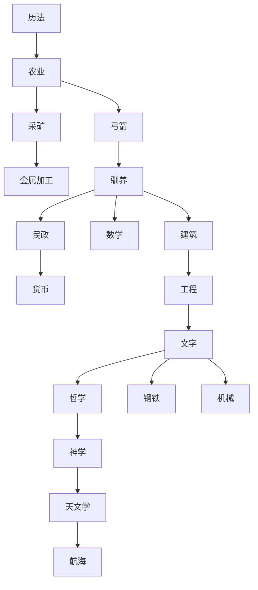

# 猫国科技线对修真研究的参考

评估日期：2026-10-14。依据工作区 `cat-zh-master/js/science.js`、`js/workshop.js`、`js/buildings.js`，并核对官方仓库当前源码。本文件是结构评估与重组建议，不是已应用的游戏规则。

官方来源：[科技定义](https://github.com/nuclear-unicorn/kittensgame/blob/master/js/science.js)、[工坊定义](https://github.com/nuclear-unicorn/kittensgame/blob/master/js/workshop.js)、[建筑定义](https://github.com/nuclear-unicorn/kittensgame/blob/master/js/buildings.js)。本地副本的部分内容与当前官方版本不同，下述早期科技解锁关系在两者中一致。

## 猫国的实际安排

早期关系（省略建筑、工坊升级与政策）：

重要特点：

- 有连续主干，也有关键分叉。农业开放采矿、弓箭；驯养开放民政、数学、建筑；文字开放哲学、钢铁、机械。不是所有领域各自从开局并行。
- 科技开放整类能力：建筑、职业、配方、后续科技和工坊升级。采矿开放矿场与工坊，数学开放学院，机械开放蒸汽工厂；节点的回报容易辨认。
- 工坊承接大量专业增益，例如锄具、斧具、锯具和仓储强化。科技页不用逐个容纳这些升级。
- 研究费用也控制节奏：文字需 3600 科学，随后哲学、钢铁、机械分别需 9500、12000、15000。早期科技主要用科学，后期加入手稿、纲要、蓝图等加工品；扩科研容量和建立材料产业同时推进。
- 显示由科技是否已解锁决定，科技购买又受资源条件限制。没有全页固定三项的显示上限；未研究的已开放分支可以积累。
- 科技的 `unlocks.tech` 是父节点直接开放后续节点。它不是本项目所有 `needs.upgrades` 必须同时满足的条件表，迁移结构时不能直接混同两种规则。

## 当前修真线的问题

当前有 88 个核心修真节点和 2 个猎杀模块节点。知识、配方、设施、制度、纯增产、扩仓、加工提速都在修真页，分布于许多研究分组。即使每个节点都有前置，几条材料线与经营线同时成熟后，研究入口仍会堆积。

前两轮收紧解决了部分过早露面的问题，但不能代替整体分工。为了减少可见选项而强接无直接知识关系的节点，会增加记忆负担和产业耦合。例如“淬玄工艺 → 流水作坊”可以保持可达，却需要比“二者从共同工程知识分叉”更充分的理由；猫国的钢铁与机械实际是文字之后的并行分支。

## 建议的重组原则

1. 先区分核心研究与应用增益，再设计科技树。核心研究负责新材料、新配方、新设施、新系统；单纯增产、扩仓或提速的节点优先归技艺。主题上属于心法的节料、调养、修持效果也可单独归心法，而不是插在材料主干里。
2. 使用少量共同知识节点承接阶段分叉；优先复用已有研究及其实际成果，不增加只收费的通行证。
3. 核心研究按认识推进：观气、计量、凝聚、晶体、离析、解离、湮灭。营造、符阵、讲经等应用在相关知识阶段开放，专业精研在应用能力形成后出现。
4. 普通研究尽量只新开放一两项后续研究，关键节点允许两三条路线。这是本项目的设计目标，不是猫国对所有节点或整个页面的硬性限制。
5. 新材料首次来源必须在下游使用前成立；扩仓设施的解锁研究必须由上游仓容承接。保留旧档已学资格，并检查完整研究图与资源、建筑依赖，不能只检查研究节点之间有没有环。
6. 一次解锁几项与一路升级多快分别评估。调整显示和前置后，还应测量阶段停留时间与投资回报，不能假定它自然延长飞升耗时。

## 金丹九项的功能归类建议

| 节点 | 主要功能 | 借鉴猫国后的建议 |
| --- | --- | --- |
| 凝气化液 | 新资源配方 | 核心研究 |
| 导灵纹 | 符文结构与后续工艺资格 | 核心研究 |
| 土木精要 | 开放材料库 | 营造研究 |
| 淬玄工艺 | 开放玄钢配方 | 材料研究 |
| 讲经法 | 开放讲经堂与科研发展 | 宗门制度研究 |
| 香火志 | 开放香火鼎 | 香火研究 |
| 兽材加工 | 开放兽骨炼器配方 | 可选材料研究，保留猎杀模块开关 |
| 破境心法 | 破境费用降低 | 建议归心法或技艺的应用增益 |
| 流水作坊 | 木作加工容量提高 | 建议归技艺的工程升级 |

这是功能归类建议；不能把剩下七个核心节点同时开放，仍需在各自知识阶段分批承接。具体移动节点、最终主干和费用梯度尚未应用。现有的局部递进关系以 `RESEARCH.md` 与实际数据为准。

## 本轮实施

已将 16 个应用升级迁至技艺，保留 ID、费用、效果与维护费；修真由 90 项减至 74 项。流水作坊改由阵基装配承接，与淬玄分支独立；自动制作与自动调速改由基础知识承接，不要求先购买相应扩产升级。其余知识主干沿用已有节点；晶纹精修与疾炼法仍有新能力或知识承接职责，保留修真。当前规则见 [RESEARCH.md](RESEARCH.md)。上述对照表是重组前的分析，不作为当前页面归属清单。
